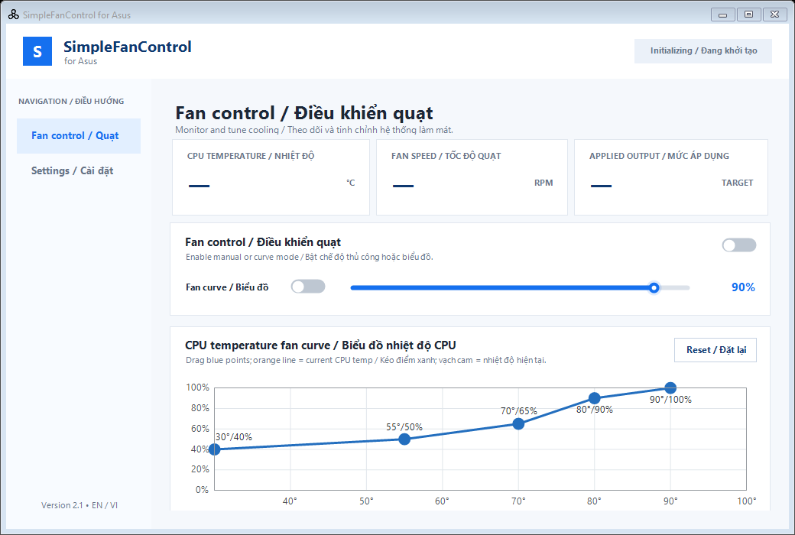

# SimpleFanControl for Asus

Modern bilingual fan control for compatible Asus laptops. The project is based
on [Karmel0x/AsusFanControl](https://github.com/Karmel0x/AsusFanControl) and keeps
that repository as its upstream history.



## Features / Tính năng

- English and Vietnamese interface / Giao diện song ngữ Anh–Việt.
- Live CPU temperature, fan RPM and applied output.
- Manual fan control and draggable temperature curve.
- Current CPU temperature marker on the curve.
- Polling intervals of 1, 2, 3, 5 or 10 seconds; default is 2 seconds.
- Auto-refresh, system tray and automatic firmware reset on exit.
- Optional Windows sign-in startup through a highest-privilege Scheduled Task.

Default curve / Đường cong mặc định:

`30°C/40% → 55°C/50% → 70°C/65% → 80°C/90% → 90°C/100%`

## Repository layout / Cấu trúc

```text
src/
  AsusFanControl/             Core hardware and CLI
  SimpleFanControlForAsus/    WinForms desktop application
docs/                         Screenshots and user guide
scripts/                      Bootstrap, build and package scripts
tools/                        Local runtime dependency location
build/                        Generated binaries (ignored)
dist/                         Generated release packages (ignored)
archive/                      Recoverable legacy packages (ignored)
```

## Build / Biên dịch

Requirements:

- Windows x64
- .NET Framework 4.7.2 runtime
- PowerShell
- Visual Studio Build Tools, or the Windows Framework MSBuild fallback

```powershell
.\scripts\bootstrap.ps1
.\scripts\build.ps1
```

The build is written to `build\bin\x64\Release`.

To create a runnable package, place the official Microsoft Sysinternals
`PsExec.exe` at `tools\PsExec.exe`, then run:

```powershell
.\scripts\package.ps1
```

The package is written to `dist\SimpleFanControl-for-Asus-v2.1.0` and includes
SHA-256 checksums.

## Run / Chạy ứng dụng

Open `SimpleFanControlForAsus.exe` from the generated package. On systems that
require SYSTEM access, the executable redirects through `run.bat` and PsExec.

The ASUS System Control Interface and `ASUS System Analysis` service must be
installed and running. `AsusWinIO64.dll` is licensed to ASUSTek Computer Inc.

## Safety / An toàn

Fan control directly affects cooling hardware. Keep `Safe output limits`
enabled unless you understand the consequences. Turning control off or exiting
the application returns all fans to ASUS firmware control.
